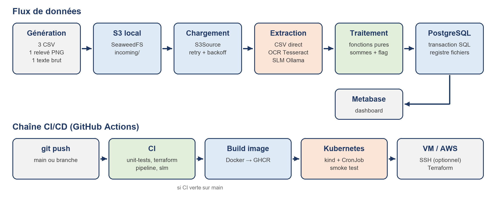

# Pipeline data CI/CD

[](https://github.com/yuba0/CI_CD_Data_Transactions/actions/workflows/ci.yml)
[](https://github.com/yuba0/CI_CD_Data_Transactions/actions/workflows/cd.yml)

Ce dépôt contient une pipeline de transactions financières, testée et déployée automatiquement. Des fichiers **CSV**, des **images de relevés** et des **textes libres** sont déposés dans un S3. La pipeline les traite par des fonctions Python pures, puis les insère dans **PostgreSQL**. Les résultats sont consultables dans un dashboard **Metabase**.

> Le rapport complet, avec les captures d'écran, se trouve dans [docs/Rapport_Pipeline_CI_CD.docx](docs/Rapport_Pipeline_CI_CD.docx).



## Sommaire

- [Résultats](#résultats)
- [Démarrage rapide](#démarrage-rapide)
- [Organisation du dépôt](#organisation-du-dépôt)
- [Niveau 1 : pipeline de base](#niveau-1--pipeline-de-base)
- [Niveau 2 : stockage S3 local](#niveau-2--stockage-s3-local)
- [Niveau 3 : améliorations](#niveau-3--améliorations)
- [Limites](#limites)

## Résultats

| Niveau | Consigne | Statut |
|---|---|---|
| 1 | Génération, traitement pur, base, pipeline, test d'intégration, scénario d'échec, retry d'insertion | ✅ |
| 2 | S3 local lancé par la pipeline, lecture depuis le S3, retry du téléchargement | ✅ |
| 3 | CD Docker vers Kubernetes (CronJob toutes les 5 min) ou vers une VM | ✅ testé en CI |
| 3 | OCR sur des images de transactions | ✅ |
| 3 | Petit modèle de langage (SLM) sur du texte brut | ✅ |
| 3 | Terraform pour la production AWS | ✅ validé, non appliqué |

Le dernier run sur `main` est entièrement vert :

| Workflow | Job | Durée |
|---|---|---|
| CI | `unit-tests` : 26 tests | 9 s |
| CI | `terraform` : fmt + validate | 16 s |
| CI | `pipeline` : S3 + Postgres + 11 tests d'intégration | 1 min 04 |
| CI | `slm` : Ollama + extraction | 1 min 21 |
| CD | `build-and-push` : image sur GHCR | 41 s |
| CD | `deploy-kubernetes` : kind + smoke test | 1 min 55 |

## Démarrage rapide

Prérequis : Python 3.9 ou plus, Docker et Tesseract (`brew install tesseract`).

```bash
python3 -m venv .venv && .venv/bin/pip install -r requirements-dev.txt

./scripts/run_pipeline.sh                    # rejoue toute la CI en local
docker compose --profile dashboard up -d     # Metabase : http://localhost:3001
```

Dans Metabase, ajoute une base PostgreSQL avec les paramètres suivants : hôte `postgres`, port `5432`, base `transactions`, utilisateur et mot de passe `pipeline`. Les vues `v_total_*` sont prêtes à être affichées.

| Service | Port local |
|---|---|
| PostgreSQL | 5433 |
| S3 (SeaweedFS) | 8333 |
| Metabase | 3001 |
| Ollama | 11434 |

<details>
<summary>Commandes de la pipeline</summary>

```bash
python -m pipeline generate --out data [--no-images] [--texts]
python -m pipeline upload   --dir data
python -m pipeline init-db
python -m pipeline process  --source s3|local [--loop --interval 60]
```

Variables utiles : `INJECT_BUG=generation`, `FAIL_INSERT_TIMES=N`, `FAIL_S3_GET_TIMES=N`, `DATABASE_URL`, `S3_ENDPOINT`.
</details>

## Organisation du dépôt

```
pipeline/
  generate.py          données CSV fixes (niveau 1)
  generate_extra.py    relevé PNG et texte brut (niveau 3)
  processing.py        fonctions PURES : validation, sommes, flag
  loader.py            chargement local ou S3, retry
  extractors.py        CSV / OCR / SLM -> lignes au format CSV
  db.py                insertion atomique, retry, registre
  retry.py             retry avec backoff exponentiel
  faults.py            pannes simulées
sql/schema.sql         schéma relationnel
tests/
  expected.py          résultats attendus calculés à la main
  unit/  integration/  slm/
k8s/                   manifestes Kubernetes
infra/terraform/       S3, RDS, EC2 sur AWS
.github/workflows/     ci.yml, cd.yml
docs/                  rapport, schéma, captures d'écran
```

## Niveau 1 : pipeline de base

**Données testables.** Trois CSV de 5, 6 et 7 transactions sont écrits en dur, avec des cas limites : `5000.00` (pas flaggé), `5000.01`, et deux IBAN dans la même banque. La colonne `montant` est ajoutée au format du sujet. Les résultats attendus sont **calculés à la main** dans `tests/expected.py` et ne sont jamais recalculés par le code testé.

**Traitement pur.** `processing.py` calcule les sommes envoyées par IBAN et par banque, les sommes reçues par IBAN, et flague les montants **strictement** supérieurs à 5000. Ce module ne fait aucune I/O, utilise `Decimal` pour les montants et renvoie des objets immuables.

**Base de données.**

| Table / vue | Contenu |
|---|---|
| `processed_files` | Registre des fichiers traités : nom et empreinte sha256 |
| `transactions` | Une ligne par transaction, avec `is_flagged` |
| `sent_by_iban`, `sent_by_bank`, `received_by_iban` | Agrégats par fichier |
| `v_total_*`, `v_flagged_transactions` | Totaux tous fichiers confondus |

**Pipeline CI.** Les étapes s'enchaînent ainsi : S3 + Postgres → génération → dépôt dans le S3 → schéma → traitement → re-run, qui ne doit rien traiter → tests d'intégration, qui vérifient 22 transactions, un total de 76 872,74, les sommes et 8 transactions flaggées.

**Scénarios d'échec** (captures dans [docs/screenshots](docs/screenshots)) :

- *Bug de génération* : lancer *Run workflow* avec `inject_bug = generation`. Un montant devient `12O0.00`, les fichiers sont rejetés, la CI est rouge et la CD ne se déclenche pas.
- *Bug de traitement* : sur la branche `bug/flag`, remplacer `>` par `>=`. Le test `test_flag_threshold_is_strict[5000.00-False]` échoue dès le premier job.

**Retry d'insertion.** Avec `FAIL_INSERT_TIMES=N`, l'insertion plante après l'écriture de lignes et avant le commit. Le retry fait jusqu'à 5 tentatives avec un backoff de 0,5 s, 1 s, 2 s, etc. Le ROLLBACK garantit qu'il ne reste **aucune ligne partielle**.

**Ne jamais traiter deux fois un fichier.** Trois garde-fous :

1. le registre est consulté par nom **ou** par empreinte, donc une copie renommée est ignorée ;
2. l'inscription au registre et l'insertion des données sont dans **une seule transaction SQL** ;
3. des contraintes `PRIMARY KEY`/`UNIQUE` avec `ON CONFLICT DO NOTHING` bloquent les doublons, même avec des traitements en parallèle.

## Niveau 2 : stockage S3 local

- **SeaweedFS**, compatible S3, tourne dans un seul conteneur. Il est démarré en première étape de la CI.
- `python -m pipeline upload` dépose les fichiers dans `s3://transactions/incoming/`.
- `process --source s3` lit depuis le S3 (`S3Source`), avec la même interface que la source locale.
- Le téléchargement a un retry. Le test `test_s3_download_retry` le vérifie avec `FAIL_S3_GET_TIMES=2`.

## Niveau 3 : améliorations

### CD avec Docker vers Kubernetes et/ou une VM

Quand la CI est verte sur `main`, la CD construit l'image (qui contient Tesseract) et la publie sur GHCR. Elle crée ensuite un cluster **kind** et y déploie `k8s/` :

- PostgreSQL en StatefulSet ;
- SeaweedFS en Deployment avec un PVC ;
- le traitement en **CronJob toutes les 5 minutes**, avec `concurrencyPolicy: Forbid`.

Le script `scripts/deploy_k8s.sh --smoke-test` dépose les fichiers, lance le CronJob et vérifie qu'il y a 22 transactions en base. Il relance ensuite le CronJob et vérifie que rien n'est retraité.

Le déploiement sur VM (`docker-compose.prod.yml`, par SSH) s'active avec la variable de dépôt `DEPLOY_VM=true`. Il demande aussi les secrets `VM_HOST`, `VM_USER`, `VM_SSH_KEY`, `POSTGRES_PASSWORD`, `S3_SECRET_KEY` et `GHCR_PAT`.

### OCR (images)

Tesseract lit le relevé `releve_2026-01-04.png`. La fonction pure `parse_ocr_text` retire les espaces parasites dans les IBAN et vérifie les formats : une ligne mal lue provoque une erreur, jamais une donnée fausse. Les 4 transactions de l'image font partie des 22 vérifiées en base.

### Petit modèle de langage (texte brut)

Ollama sert le modèle `qwen2.5:1.5b`, avec un schéma JSON imposé, `temperature=0` et `seed=42`. Un **garde-fou contre les hallucinations** exige que chaque IBAN et chaque montant extrait apparaisse mot pour mot dans le texte source.

```bash
docker compose --profile slm up -d --wait ollama
docker compose exec ollama ollama pull qwen2.5:1.5b
pytest tests/slm
```

### Terraform (AWS)

`infra/terraform/` décrit :

- un bucket S3 chiffré et privé ;
- une base RDS PostgreSQL accessible uniquement depuis la VM ;
- une VM EC2 qui lance le conteneur au démarrage, avec un rôle IAM et sans clé stockée.

La CI exécute `terraform fmt` et `terraform validate`. Pour déployer :

```bash
cd infra/terraform && cp terraform.tfvars.example terraform.tfvars
terraform init && terraform apply      # puis : terraform destroy
```

## Limites

- Terraform est validé mais n'a pas été appliqué sur un compte AWS réel.
- Le cluster kind est éphémère : il sert à tester le déploiement. Une vraie production utiliserait un cluster managé.
- Un fichier rejeté est retenté à chaque exécution. Une mise en quarantaine avec alerte serait préférable.
- Le garde-fou du SLM n'empêche pas une inversion entre l'émetteur et le destinataire.
